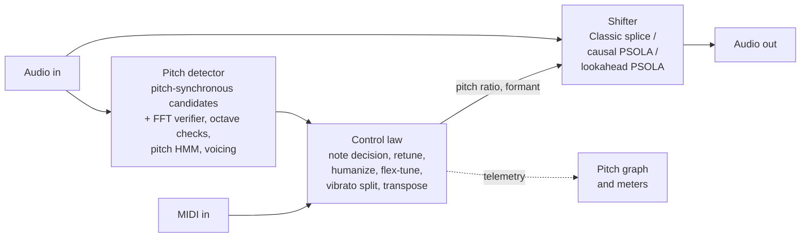
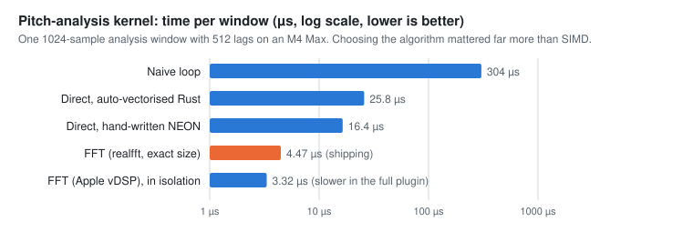
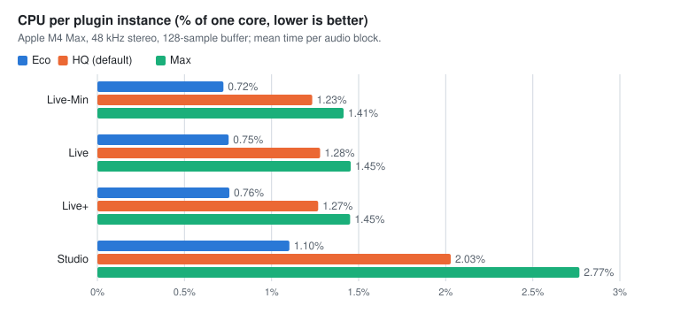

# Skatotune

**Open-source real-time vocal pitch correction, written in Rust.** Skatotune is a VST3 and CLAP plugin (plus a standalone app) that tunes a singing voice live, Auto-Tune style. It has a formant-preserving natural mode, a classic hard-tune mode, and a scrolling pitch graph that shows exactly what it is doing to your voice.

<p align="center">
  
  <br><sub>The editor with the Hard Tune preset, rendered from the plugin's GUI using its built-in demo data.</sub>
</p>

> **Status:** v1, pre-release. It builds, passes its plugin validators and quality gates, and runs in Bitwig; checks in more hosts are ongoing ([#19](https://github.com/sdunifon/skatotune/issues/19)). Expect rough edges; see [Known limitations](#known-limitations).

---

## Contents

- [Features](#features)
- [Compatibility](#compatibility)
- [Install and build](#install-and-build)
- [How it works](#how-it-works)
- [How well it works](#how-well-it-works)
- [Rust and performance](#rust-and-performance)
- [Did we use AI models?](#did-we-use-ai-models)
- [How Skatotune compares to Auto-Tune](#how-skatotune-compares-to-auto-tune)
- [Roadmap](#roadmap)
- [Contributing, license, credits](#contributing-license-credits)

---

## Features

**Correction**
- **Two engines.** *Natural* shifts pitch one voice cycle at a time (PSOLA), so formants stay put and the voice keeps its character. *Classic* is the resample-and-splice method of the original (now expired) Auto-Tune patent: the hard-tune sound, at about 1 ms.
- **Key and scale** (13 scales) with **per-note states**: *On* (snap to it), *Bypass* (leave pitch near it untouched), *Remove* (pull to a neighbour).
- **The familiar controls:** Retune speed, Note transition, Humanize, Flex-Tune, Amount, Tolerance, Snap min/max, Detune, Transpose, Formant shift (± 12 st, cleanest within ± 3), Tracking and input gate.
- **Vibrato-aware correction.** Skatotune separates each note's centre from its vibrato, tunes the centre and puts the singer's vibrato back, so hard tuning no longer flattens vibrato unless you want it to (Vibrato depth −100 … 200 %). Optional synthetic vibrato.
- **MIDI target notes.** Play the notes you want (*Target*), teach the plugin a scale from MIDI (*Learn*, saved with the project), or fall back to the scale when no key is held (*Auto*). Pitch bend and sustain work.
- **Presets:** Hard Tune, Natural, Live Safe, Classic.

**Latency and quality you choose separately**
- **Latency modes:** *Live-Min* (~1 ms, Classic), *Live* (3.1-5.9 ms by voice range), *Live+* (5-10 ms) and *Studio* (20-50 ms lookahead, compensated by the DAW). The latency the plugin reports is exactly the latency you get, verified for every mode, voice range and sample rate.
- **Quality tiers** Eco / HQ / Max inside every mode: more CPU buys better analysis, never more latency.
- **Voice ranges** (Low Male, Alto/Tenor, Soprano, Wide) tune the analysis to the singer.

**See what it's doing**
- **Scrolling pitch graph:** sung pitch, vibrato-free centre, corrected output and target notes on a piano roll, with live cents meters for "input vs target" and "correction".
- **Correction coloring** (in the Labs menu): the gap between your voice and the output is shaded by how hard the plugin is pulling, from faint to bright.
- **Latency readout:** the reported latency plus the average delay you actually hear for the note you're singing, and a CPU meter.

<p align="center">
  
</p>

The **Labs** menu holds experimental features before they're promoted to the main UI. Correction coloring comes in five themes: Teal, Green → Red, Viridis, Inferno and Blue → Orange (three of them are color-blind safe).

<p align="center">
  
</p>

**Built for live use**
- Nothing on the audio thread allocates, locks or can panic; this is enforced by tests.
- Output is bit-identical regardless of the host's buffer size; NaN or extreme input can't break it.
- Stereo, mono and mono-to-stereo; 44.1 to 192 kHz.

## Compatibility

| | Status |
|---|---|
| **Formats** | VST3, CLAP, standalone app. Audio Unit (Logic, GarageBand) planned ([#21](https://github.com/sdunifon/skatotune/issues/21)) |
| **DAWs** | Target hosts: Bitwig Studio 6 (CLAP and VST3) and Ableton Live 12 (VST3). Other VST3/CLAP hosts should work but are untested; a full in-DAW checklist is tracked in [#19](https://github.com/sdunifon/skatotune/issues/19) |
| **macOS** | Apple Silicon (primary; developed on an M4 Max). Intel Macs build but are not yet tested natively |
| **Windows / Linux** | Builds are planned with CI ([#22](https://github.com/sdunifon/skatotune/issues/22), [#31](https://github.com/sdunifon/skatotune/issues/31)); not yet tested |
| **Validators** | clap-validator (37 passed, 0 failed), Steinberg VST3 validator (47/47), pluginval at strictness 10 (pass) |
| **Audio** | 44.1-192 kHz; mono, stereo, mono → stereo; MIDI input for target notes |

## Install and build

Pre-built releases will come from CI ([#31](https://github.com/sdunifon/skatotune/issues/31)). Until then, build from source. You need Rust; the exact toolchain is pinned in `rust-toolchain.toml` and installs automatically.

```sh
git clone https://github.com/sdunifon/skatotune.git
cd skatotune
cargo xtask bundle skatotune --release
```

Then copy the bundles into your plugin folders and rescan in your DAW:

```sh
cp -R target/bundled/Skatotune.clap ~/Library/Audio/Plug-Ins/CLAP/
cp -R target/bundled/Skatotune.vst3 ~/Library/Audio/Plug-Ins/VST3/
```

Run it without a DAW (pick your audio devices in the terminal; use headphones):

```sh
cargo standalone
```

Tests, lint and the evaluation suite:

```sh
cargo test --workspace --release
cargo clippy --workspace --all-targets --all-features -- -D warnings
cargo test -p skato_eval --release --test quality_gates
```

## How it works



The analysis never delays the audio: only the shifter needs lookahead, and that lookahead *is* the reported latency.

**1. Pitch detection.** A pitch-synchronous candidate generator (the recursive autocorrelation from the original Auto-Tune patent, which looks at only one or two cycles of the note being sung) proposes periods; an FFT-based verifier (normalized square difference plus a probabilistic YIN-style score) checks them; prime-harmonic and time-domain octave checks reject octave errors; a causal pitch HMM tracks the result, with fixed-lag smoothing in Studio mode; a voicing state machine separates singing from breath, consonants and silence. On 40 real singers it matches an offline reference tracker (94.7 % of frames within 50 cents) with a quarter of its octave errors.

**2. Deciding the note and the correction.** The control law decides which note you mean (rules in Eco, a note HMM in HQ/Max, decisions over the lookahead in Studio), then smooths the *correction* with a one-pole filter whose time constant is the Retune speed. Humanize slows correction on long sustained notes, Flex-Tune only corrects pitch that is already close, and a causal vibrato tracker splits the pitch into centre and vibrato so the centre can be tuned while the vibrato is kept or scaled.

**3. Shifting.** *Classic* resamples at the commanded ratio and repeats or drops whole voice cycles. *Natural* uses pitch-synchronous overlap-add (PSOLA): it finds each glottal cycle (pitch marks) and re-spaces short, windowed grains, which changes pitch without moving formants. *Studio* uses the same idea with real lookahead and picks the nearest grain. The formant knob reads each grain at a different rate.

The design rests on a large literature review, adversarial fact-checking and measurements, collected in the [research library](docs/research/README.md):
- [Architecture research](docs/research.md): every detector, shifter and control-law option considered, with evidence and sources.
- [Rust performance research](docs/rust-performance.md) and the measured [performance evidence](docs/PERFORMANCE.md).
- Topic reports: [following the DAW's key](docs/research/host-key-scale.md), [graph/editing mode](docs/research/graph-mode.md), and the [technique registry](docs/research/TECHNIQUES.md).

## How well it works

Everything below is measured by the repository's own evaluation harness ([`crates/skato_eval`](crates/skato_eval)), on synthetic singing with exact ground truth and on **vocadito**, 40 real a-cappella takes from 29 singers with hand-checked annotations.

<p align="center">
  
</p>

**Latency.** *Reported* is what the DAW compensates and what you hear when monitoring. *Heard* is the average delay of the corrected voice: PSOLA re-uses or skips whole voice cycles, so while it is correcting, the voice trails the reported latency by about half a cycle (more for low voices).

**Real singing** (vocadito, Live HQ hard tune unless noted):

| Measure | Result |
|---|---|
| Detector vs offline reference: frames within 50 cents | 94.7 % (reference 94.7 %) |
| Octave errors | 0.31 % (reference 1.30 %) |
| Note starts with a glitch | 6.3 % |
| Time for a note to settle on pitch, median / p90 | 27 / 66 ms (Studio: 17 / 41 ms) |
| Held-note error, in key, p95 | 14.7 cents (Studio: 8.3) |

**Synthetic quality gates** (run as tests):

| Gate | Target | Measured |
|---|---|---|
| Tuning, Live HQ (median / p95) | < 5 / < 15 cents | 1.6 / 4.9 cents |
| Settling after a note starts (Live HQ, retune 0) | every onset < 30 ms | all 18 onsets, worst 27 ms |
| Vibrato kept with preserve-vibrato on | extent within ± 15 % | 5 % |
| Latency measured = reported | every mode × range × rate | 48 / 48 |
| Transparency with correction off | exact (Classic) / ≥ 25 dB (PSOLA) | exact / 99 dB |
| CPU, Live HQ worst case (p99.9) | < 5 % of the buffer at 128 samples | 2.4 % |

## Rust and performance

**Did Rust make it faster?** Not by itself, and we'd rather say so. Rust compiles through LLVM like Clang, so careful Rust and careful C++ run at about the same speed. What Rust gave this project was **safety at speed**: the audio thread provably never allocates, the GUI can't corrupt audio state, and large refactors could be made with confidence because the compiler and 588 tests catch mistakes.

**Where the speed came from** (measured on an M4 Max, [details](docs/PERFORMANCE.md)):

<p align="center">
  
</p>

- **Algorithm first.** Computing the pitch analysis with FFTs instead of directly is 3.7× faster than the best hand-written SIMD, and 68× faster than a naive loop.
- **Code the compiler can vectorize.** Writing reductions with independent accumulators made them 7-20× faster than naive loops, and LLVM turned them into SIMD automatically.
- **Does SIMD work? Yes, but modestly at the end.** Hand-written NEON is 1.05-1.8× faster per kernel, which is worth only **2-5 % of the whole plugin**, because the compiler already vectorizes most loops.
- **Measure the whole thing.** Apple's vDSP FFT is up to 2.3× faster in isolation but made the plugin 4-13 % *slower* (our FFTs are small), so we don't ship it. `target-cpu=native` and profile-guided optimization gained about 0 %.
- **Fast math.** Polynomial approximations of exp2/log2/tanh are 3.3-4.3× faster than the standard library, with error under 0.001 cent.

<p align="center">
  
</p>

The whole plugin uses about **1.3 % of one core** in its default mode, so there is plenty of headroom; the plan is to spend it on quality ([#13](https://github.com/sdunifon/skatotune/issues/13)).

## Did we use AI models?

**Not in the plugin, on purpose (so far).** The research compared every leading neural pitch tracker (SwiftF0, RMVPE, FCPE, CREPE, PENN, streaming PESTO). The most accurate ones need **32-176 ms of lookahead**, too slow for live singing, and our DSP detector already matches an offline reference on real singers. Neural vocoders could shift pitch at ~10 ms but weren't transparent enough. The places where a small network could still help, and the research tracking them:
- an octave/voicing referee that runs alongside the DSP detector ([#14](https://github.com/sdunifon/skatotune/issues/14));
- making neural pitch tracking fast enough for live use ([#27](https://github.com/sdunifon/skatotune/issues/27));
- running inference on Apple's Neural Engine or matrix units ([#28](https://github.com/sdunifon/skatotune/issues/28)).

The code itself was written with heavy use of AI coding assistants (Anthropic's Claude) under human direction and review; see [CONTRIBUTING.md](CONTRIBUTING.md).

## How Skatotune compares to Auto-Tune

Auto-Tune has two decades of refinement by ear on real singers, and we haven't run a blind listening test against it yet ([#12](https://github.com/sdunifon/skatotune/issues/12)), so this is a feature-level comparison, not a claim about sound.

**Where Skatotune is stronger**
- **Free and open source,** with every algorithm documented and every number reproducible.
- **Latency you can trust:** the reported latency is measured to equal the real latency in every mode, voice range and sample rate, and the plugin shows you the delay you actually hear.
- **Latency and quality as separate choices:** Eco/HQ/Max tiers inside every latency mode.
- **A Studio mode with real lookahead:** notes settle in a median 17 ms on real singers, and decisions use the coming audio.
- **Vibrato-preserving hard tune** in every mode (Antares added a comparable feature, DVA, to AutoTune Advanced in 2026).
- **Light on CPU:** about 1.3 % of one core per instance.
- **A graph that shows the correction,** not just the pitch.

**Where Auto-Tune is ahead (today)**
- **Natural-mode latency:** Auto-Tune's low-latency mode reports about 2.3 ms; our Live mode reports 3.1-5.9 ms ([#8](https://github.com/sdunifon/skatotune/issues/8)). Classic modes are comparable (0.8 ms vs 1.0 ms).
- **Note decisions on real, imperfect singing:** we still glitch on about 6 % of note starts and can waver when a singer sits between notes ([#7](https://github.com/sdunifon/skatotune/issues/7)).
- **Graph Mode / ARA editing** ([#10](https://github.com/sdunifon/skatotune/issues/10)), **throat modeling** ([#9](https://github.com/sdunifon/skatotune/issues/9)), **Auto-Key** detection ([#6](https://github.com/sdunifon/skatotune/issues/6)), and Audio Unit/AAX formats.

Auto-Tune's latency figures are host-reported values from Sound On Sound's January 2026 review; we haven't measured Auto-Tune ourselves.

## Known limitations

- Real singing is harder than the synthetic tests: held-note error is higher (p95 23-30 cents chromatic) and note starts still glitch about 6 % of the time.
- In Live mode, low voices hear about half a voice cycle more than the reported latency (8.7 ms average for low male voices).
- A CLAP latency change (switching latency mode) needs the host to restart the plugin.
- Builds are ad-hoc signed; macOS may ask you to allow them until releases are notarized ([#20](https://github.com/sdunifon/skatotune/issues/20)).

The full list, with numbers, is in [docs/STATUS.md](docs/STATUS.md).

## Roadmap

Work is tracked in [GitHub issues](https://github.com/sdunifon/skatotune/issues). Highlights:
- Better note decisions on real singing: onset cues, a musical note model ([#7](https://github.com/sdunifon/skatotune/issues/7))
- Lower natural-mode latency ([#8](https://github.com/sdunifon/skatotune/issues/8))
- Follow the DAW's key, and Auto-Key detection ([#5](https://github.com/sdunifon/skatotune/issues/5), [#6](https://github.com/sdunifon/skatotune/issues/6))
- Graph / editing mode ([#10](https://github.com/sdunifon/skatotune/issues/10)), throat model ([#9](https://github.com/sdunifon/skatotune/issues/9))
- CI with releases for macOS, Windows and Linux ([#31](https://github.com/sdunifon/skatotune/issues/31)); Audio Unit ([#21](https://github.com/sdunifon/skatotune/issues/21))

## Contributing, license, credits

- **Contributing:** see [CONTRIBUTING.md](CONTRIBUTING.md) and the [code of conduct](CODE_OF_CONDUCT.md).
- **License:** [ISC](LICENSE). Third-party licenses are in [THIRD-PARTY-NOTICES.txt](THIRD-PARTY-NOTICES.txt) and inside every bundle.
- **Built on** [nice-plug](https://codeberg.org/RustAudio/nice-plug) (the community continuation of NIH-plug), [egui](https://github.com/emilk/egui), [RustFFT](https://github.com/ejmahler/RustFFT)/[realfft](https://github.com/HEnquist/realfft), and the CLAP and VST3 SDKs.
- **Evaluation data:** vocadito (Bittner et al., 2021, [CC BY 4.0](https://zenodo.org/records/5578807)); it is downloaded for evaluation and not redistributed here.
- **Prior art:** the methods build on published research and expired patents (Hildebrand's Auto-Tune patent US 5,973,252; IVL's formant patent US 5,567,901), credited in [docs/research.md](docs/research.md).
- **Trademarks:** Auto-Tune, VST, Ableton, Bitwig and other names belong to their owners; Skatotune is not affiliated with them. See [TRADEMARKS.md](TRADEMARKS.md).
