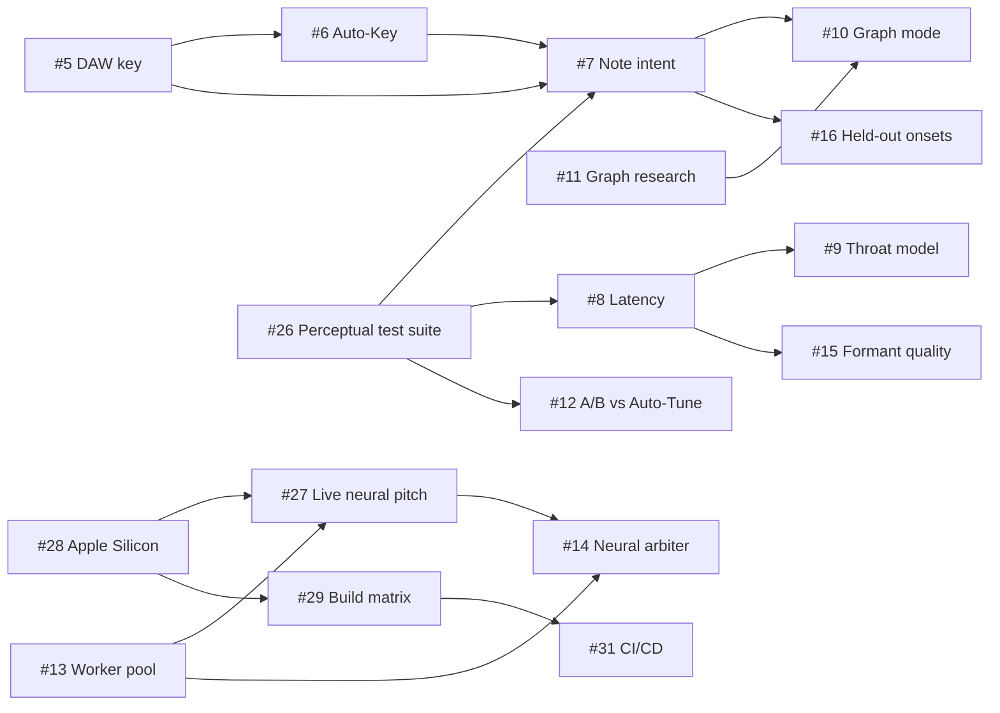

# Skatotune research library

Skatotune is a research-heavy project: most design decisions rest on measurements and on the literature. This folder is the shared memory for that research. Techniques found while researching one feature often help another, so every research task reads this library first and writes back to it.

## How we research

1. **Read first.** Before starting, read this index and [`TECHNIQUES.md`](TECHNIQUES.md), and note which earlier findings the new work builds on.
2. **Write back.** Put the report in this folder (or update an existing one) and add every technique you evaluated to `TECHNIQUES.md`, with its evidence, status and **all** the GitHub issues it could help, not only the one you were working on.
3. **Cross-pollinate.** End by checking the new findings against every open issue and leave a comment on any issue a finding could help.
4. **Measure, don't guess.** Mark facts, weak evidence and inference separately, cite sources, and say when something is unconfirmed.

## Reports

| Report | Date | Status | Key takeaways | Issues it informs |
|---|---|---|---|---|
| [Architecture research](../research.md) | 2026-10-08 | Baseline for v1 (verified) | DSP beats neural for live tuning (neural trackers need 32-176 ms lookahead); pitch-synchronous E/H + FFT NSDF/CMNDF + causal HMM detector; causal PSOLA (Live) / lookahead PSOLA (Studio) / Classic splice; Auto-Tune-style control law with vibrato split; latency × quality grid; evaluation plan; IP review | #6, #7, #8, #9, #13, #14, #15, #27 |
| [Rust performance and real-time engineering](../rust-performance.md) | 2026-10-08 | Baseline (verified) | FFT-first kernels, SIMD layers, fast math, denormals, allocation-free design, worker-thread pool with macOS work intervals, the performance/RT-safety test plan | #13, #28, #29, #31 |
| [Performance evidence](../PERFORMANCE.md) | 2026-10-09 | Living document | Measured kernel and engine costs; FFT route 3.7-11× vs direct SIMD; hand NEON only 2-5 % end to end; vDSP slower end to end; `target-cpu=native`/PGO ≈ 0 % | #28, #29 |
| [Following the DAW's key](host-key-scale.md) | 2026-10-09 | Done, design awaiting decisions | No DAW sends its key to third-party plugins today (CLAP has no extension; VST3 `kScaleEvent` exists but no host is documented as sending it); Key Source design (Manual / Host / MIDI Scale / Detect); Bitwig Key Filter+ → MIDI workaround | #5, #6, #7, #30 |
| [Graph / editing mode](graph-mode.md) | 2026-10-09 | Done, 11 open questions | Neither Bitwig nor Live hosts ARA, so in-host graph mode must be capture-based; recommended MVP: capture pitch, analyse offline, edit Melodyne-style notes, play back from a timeline; about 9-14 engineer-weeks | #10, #11, #7, #21 |
| Note intent (deciding which note a singer means) | 2026-10-09 | In progress | See the interim results on #7 and the entries tagged #7 in `TECHNIQUES.md` | #7, #6, #10, #16 |
| Latency deep dive | queued | Not started | Goal: formant-preserving Live mode at or below Auto-Tune's ~2.3 ms | #8, #9, #15 |
| Perceptual test suite | queued | Not started | Make the test suite measure what listeners hear | #26, #12 |
| Apple Silicon and the Neural Engine | queued | Not started | Viability of Neural Engine / BNNS Graph / SME2 / Accelerate for live and offline work | #28, #29, #27, #14 |
| Live neural pitch tracking | backlog | Not started | How to cut neural pitch trackers' lookahead to a few ms | #27, #14 |

The current state of the plugin, with all measured numbers, is in [`../STATUS.md`](../STATUS.md); the build contract is [`../DESIGN.md`](../DESIGN.md).

## How the work connects

Arrows mean "findings from A feed B". Numbers are GitHub issues.

